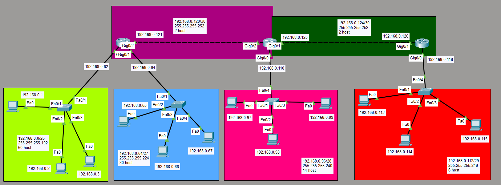

# Day 03 - VLSM (Variable Length Subnet Masking) Lab

## Objective
Design and implement an efficient IPv4 addressing scheme using **VLSM** from the base network `192.168.0.0/24` to accommodate 4 LANs with different host requirements (60, 30, 14, and 6 hosts) and 2 point-to-point router links (2 hosts each), then configure the routers and end devices to achieve full end-to-end connectivity.

---

## Network Topology

> **Tool Used:** Cisco Packet Tracer  
> **Lab File:** [Download Lab File (VLSM.pkt)](./VLSM.pkt)

---

## VLSM Subnetting Plan

| Segment | Required Hosts | Network Address | Subnet Mask | Usable IP Range | Broadcast Address |
| :--- | :---: | :--- | :--- | :--- | :--- |
| **LAN 1 (Green)** | 60 | `192.168.0.0/26` | `255.255.255.192` | `192.168.0.1` – `192.168.0.62` | `192.168.0.63` |
| **LAN 2 (Blue)** | 30 | `192.168.0.64/27` | `255.255.255.224` | `192.168.0.65` – `192.168.0.94` | `192.168.0.95` |
| **LAN 3 (Pink)** | 14 | `192.168.0.96/28` | `255.255.255.240` | `192.168.0.97` – `192.168.0.110` | `192.168.0.111` |
| **LAN 4 (Red)** | 6 | `192.168.0.112/29` | `255.255.255.248` | `192.168.0.113` – `192.168.0.118` | `192.168.0.119` |
| **Link R1–R2 (Purple)** | 2 | `192.168.0.120/30` | `255.255.255.252` | `192.168.0.121` – `192.168.0.122` | `192.168.0.123` |
| **Link R2–R3 (Dark Green)** | 2 | `192.168.0.124/30` | `255.255.255.252` | `192.168.0.125` – `192.168.0.126` | `192.168.0.127` |

---

## Device Addressing Table

### Routers
| Device | Interface | IP Address | Subnet Mask | Connected To |
| :--- | :--- | :--- | :--- | :--- |
| **R1** | `Gig0/0` | `192.168.0.62` | `255.255.255.192` | LAN 1 (SW1 - Fa0/4) |
| **R1** | `Gig0/1` | `192.168.0.94` | `255.255.255.224` | LAN 2 (SW2 - Fa0/1) |
| **R1** | `Gig0/2` | `192.168.0.121` | `255.255.255.252` | R2 (`Gig0/2`) |
| **R2** | `Gig0/0` | `192.168.0.110` | `255.255.255.240` | LAN 3 (SW3 - Fa0/4) |
| **R2** | `Gig0/2` | `192.168.0.122` | `255.255.255.252` | R1 (`Gig0/2`) |
| **R2** | `Gig0/1` | `192.168.0.125` | `255.255.255.252` | R3 (`Gig0/1`) |
| **R3** | `Gig0/0` | `192.168.0.118` | `255.255.255.248` | LAN 4 (SW4 - Fa0/4) |
| **R3** | `Gig0/1` | `192.168.0.126` | `255.255.255.252` | R2 (`Gig0/1`) |

### End Devices (PCs)
| Segment | PCs IP Addresses | Subnet Mask | Default Gateway |
| :--- | :--- | :--- | :--- |
| **LAN 1** | `192.168.0.1`, `.2`, `.3` | `255.255.255.192` | `192.168.0.62` |
| **LAN 2** | `192.168.0.65`, `.66`, `.67` | `255.255.255.224` | `192.168.0.94` |
| **LAN 3** | `192.168.0.97`, `.98`, `.99` | `255.255.255.240` | `192.168.0.110` |
| **LAN 4** | `192.168.0.113`, `.114`, `.115` | `255.255.255.248` | `192.168.0.118` |

---

## Key Steps Performed
1. **VLSM Calculation:** Divided `192.168.0.0/24` starting from the largest host requirement (`/26`) down to the smallest (`/30`) to minimize IP waste.
2. **Interface Configuration:** Assigned the **last usable IP** of each LAN subnet as the Default Gateway on the router interfaces and enabled all ports (`no shutdown`).
3. **Host Configuration:** Assigned static IPs, subnet masks, and default gateways to all PCs across the 4 LANs.
4. **Routing:** Configured routing between R1, R2, and R3 so all remote subnets can communicate.

---

## Verification
- Verified interface status and IP assignments using `show ip interface brief`.
- Verified routing tables using `show ip route`.
- Tested end-to-end connectivity with `ping` across all 4 LANs — **Success**.